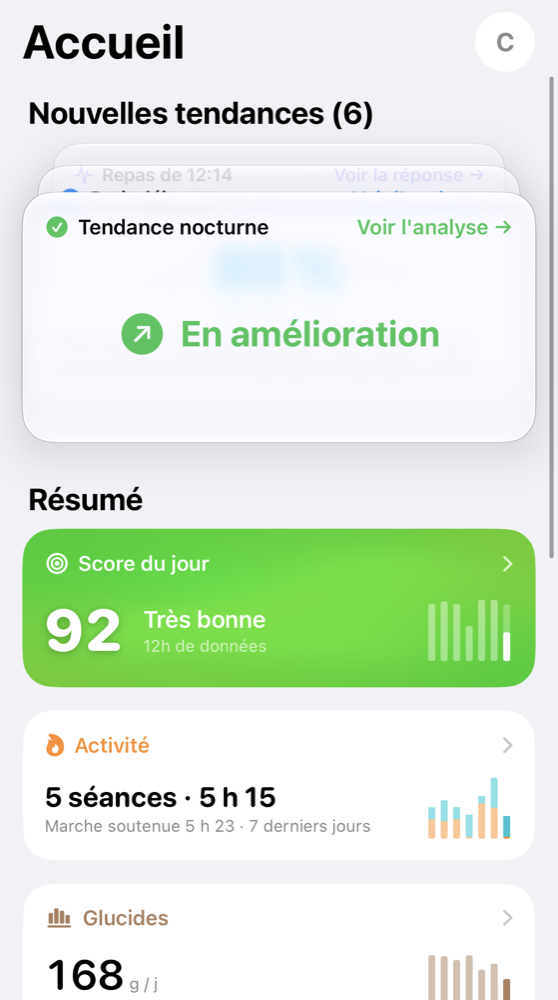
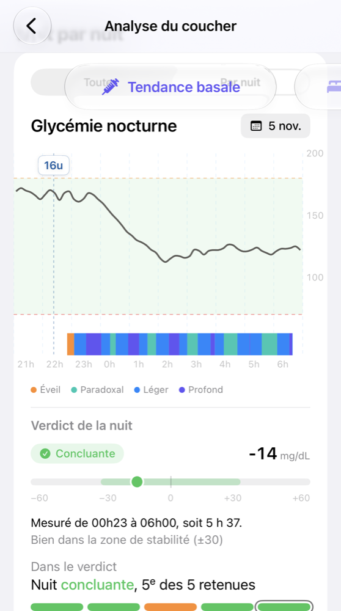
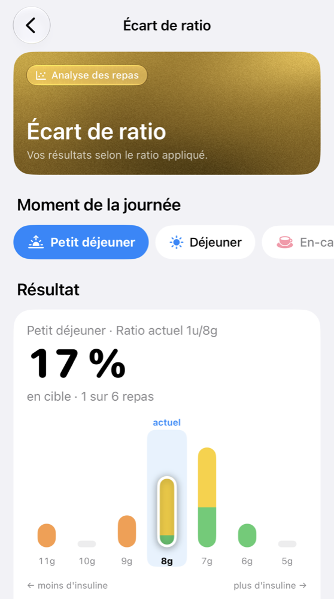
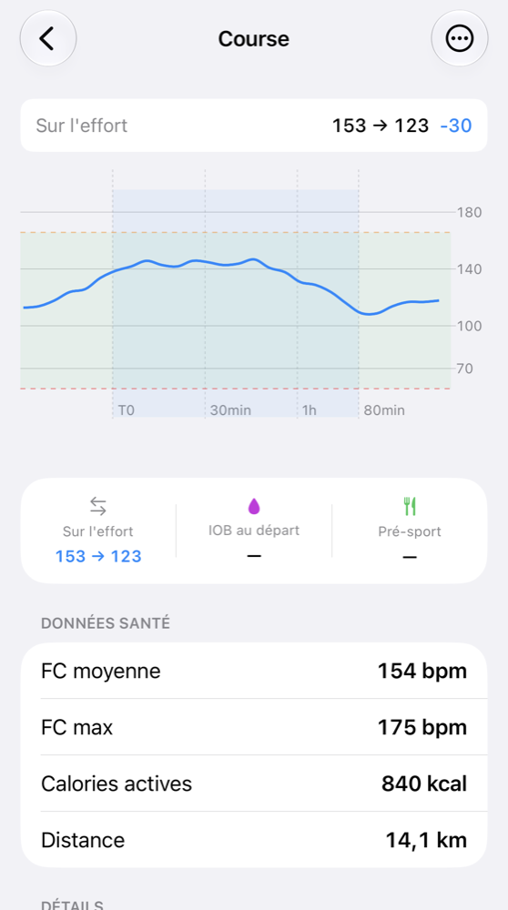
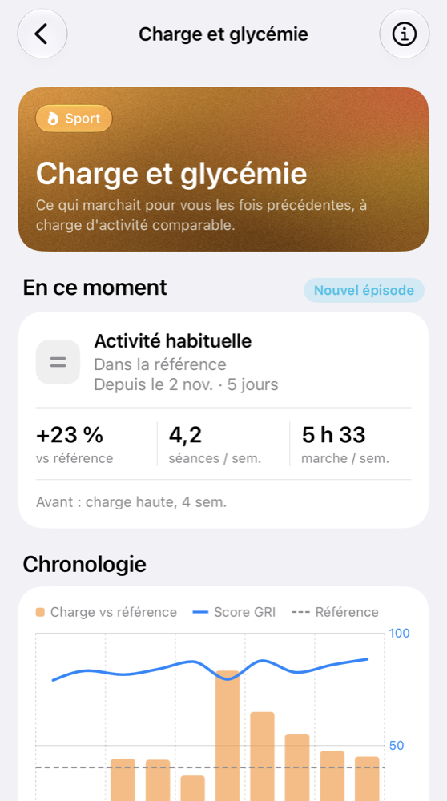
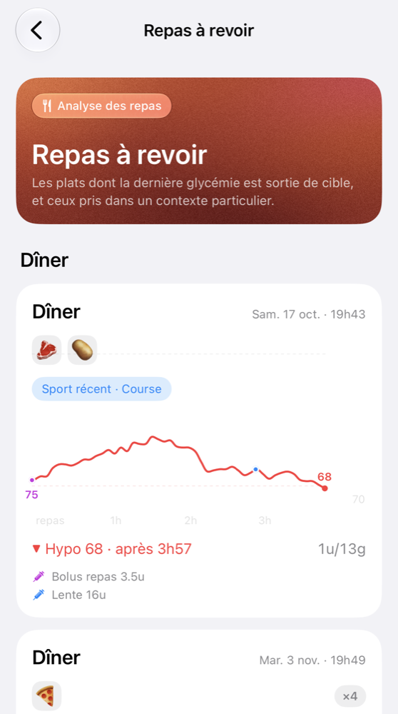
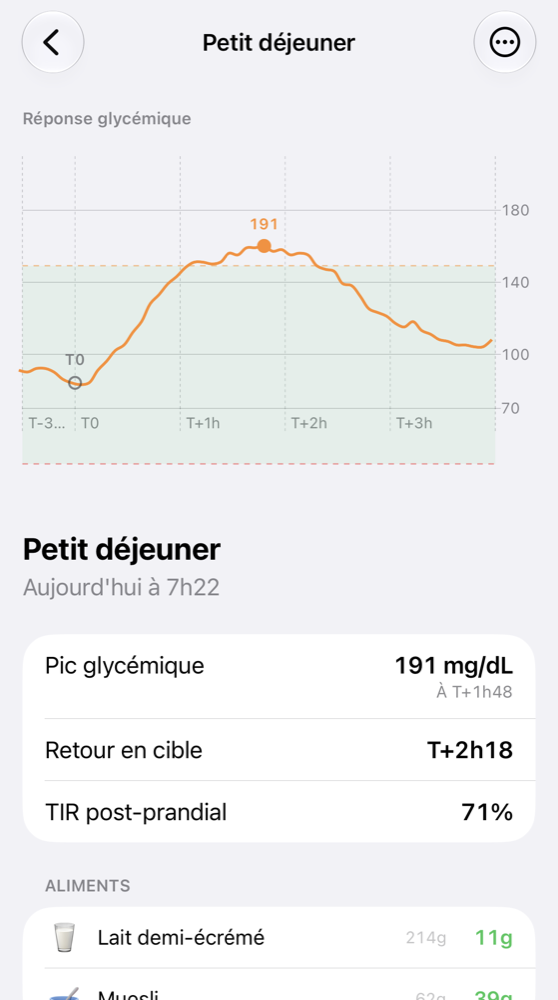
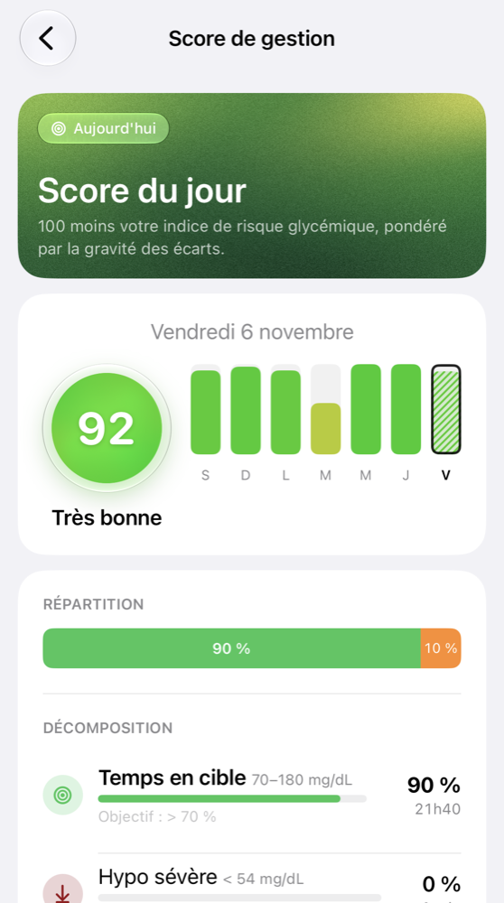
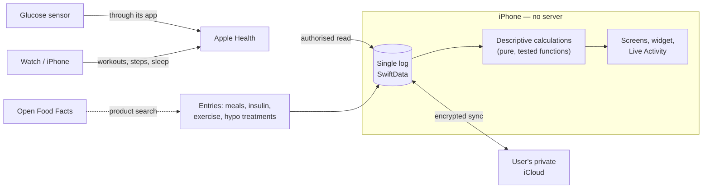

<p align="center">
  <picture>
    <source media="(prefers-color-scheme: dark)" srcset="docs/images/diaviz-icone-sombre.png">
    
  </picture>
</p>

<h1 align="center">Diaviz</h1>

<p align="center">
  An iOS app for reviewing type 1 diabetes data.<br>
  Swift 6 · SwiftUI · iOS 26 · SwiftData · CloudKit · HealthKit — fully on-device.
</p>

<p align="center"><a href="README.md">Français</a> · <b>English</b></p>

<h3 align="center"><a href="https://alexxbout.github.io/Diaviz/en/">Explore the app's concepts on the website →</a></h3>
<p align="center"><sub>What it observes, how it computes it, what it does not do. Feedback welcome.</sub></p>

> [!CAUTION]
> **Diaviz is not a medical device.** This repository contains the source code of a personal tool, shared for educational and technical demonstration purposes. It has undergone no clinical validation and no certification (CE marking), and it is not distributed as an application.
> **Do not make any treatment decision (insulin dose, hypo treatment, food, physical activity) based on this software.** If in doubt, rely on your approved glucose meter and your care team. In case of severe hypoglycaemia or any emergency, call your local emergency number (112 in Europe).

---

## About

A person living with type 1 diabetes juggles several apps every day: the glucose sensor's app, a food log, an activity tracker. The data exists, but it stays scattered, and nothing puts it side by side.

Diaviz brings these three sources into a single log and reviews them **after the fact**: how blood glucose responded to a meal, a workout, or over a night. The app describes what happened and what tends to repeat. It computes no dose and makes no recommendation.

<p align="center">
  
  
  
  
</p>

<p align="center">
  
  
  
  
</p>

<p align="center"><sub>Screenshots taken with the “Diaviz Démo” app: a fictional person, no real data.</sub></p>

## What the app shows

All analyses are **descriptive statistics** that can be recounted by hand. Each one is an observation, never a recommendation.

| Area | What is shown |
| --- | --- |
| **Daily score** | A score out of 100 derived from the *Glycemia Risk Index* (Klonoff, 2022), with its breakdown and a visual "fingerprint" of the day, also available as a Home Screen widget. |
| **Nights** | How glucose evolved overnight, split into phases anchored on the long-acting insulin time, alongside sleep stages from Apple Health. |
| **Bedtime lows** | Evening situations counted as they are, with the option to compare an evening to similar past evenings. |
| **Meals** | The glucose curve around each meal, and how the doses taken compare with the ratio the user configured, by time of day. A meal whose curve is mixed with another event (another meal, a correction, a hypo treatment, exercise, insulin still active) is set aside, with its reason. |
| **Exercise** | The glucose response to each workout, carbs taken during exercise, a live timer with Live Activity, and import of workouts from Apple Health. |
| **Activity load** | What remains active from past workouts, sustained walking included, compared with the user's own baseline over previous weeks. Load episodes are shown alongside the settings in force at the time. |
| **Insulin on board** | An estimate of the rapid-acting insulin still active, based on a published decay model. |
| **Library** | Sourced summary sheets on the scientific literature, deliberately kept apart from any personal data. |

When data is insufficient, the app says so ("not enough history yet") rather than producing a fragile result.

## Architecture

Everything runs on the iPhone: **no server, no account**.



| Layer | Choice |
| --- | --- |
| UI | SwiftUI (iOS 26, Liquid Glass), WidgetKit, ActivityKit |
| Language | Swift 6, strict concurrency |
| Storage | SwiftData as the single log (events, profile, preferences) |
| Sync | CloudKit, user's private database, plus a full JSON export/import |
| Glucose and activity | HealthKit, incremental background reads |
| Analyses | Pure, stateless calculators covered by unit tests |
| On-device AI | Apple Foundation Models, only to classify the free text describing a meal's context |
| Network | A single API: Open Food Facts product search |

### Deliberate choices

- **No machine learning.** Early plans included trained models. With one person's data volume, they would mostly have learned noise. The shipped analyses are descriptive statistics: simpler, verifiable, and honest about their uncertainty.
- **Retrospective by design.** Glucose data shared with Apple Health arrives several hours late. The app therefore claims no real-time use: it is for reviewing, not reacting.
- **A noisy analysis is worse than none.** Exclusion rules are deliberately strict, and every piece of data set aside shows its reason.
- **No backend.** Volumes are small and calculations take milliseconds: a server would only add risk.

## Repository layout

```
Diaviz/
├── app/              entry point, navigation
├── composants/       reusable SwiftUI components
├── modeles/          domain models (glucose, insulin, meals, exercise, profile…)
├── services/
│   ├── derivation/   pure calculators: nights, meals, insulin on board, load…
│   ├── hub/          services that read and write the log
│   └── sante/        Apple Health reads
└── vues/             screens (home, meals, exercise, log, analyses, profile…)
DiavizSportWidget/    widget and Live Activity
DiavizTests/          unit tests
docs/                 detailed documentation of analyses and architecture (French)
```

Technical requirements: Xcode 26, iOS 26. The code and the in-app text are in French.

## Regulatory status

- Diaviz is a **personal tool** and is not distributed.
- It is **not placed on the market**: no application is distributed (no App Store, no public TestFlight, no downloadable binary). Only the source code is published.
- It is **not a medical device** within the meaning of Regulation (EU) 2017/745 and bears **no CE marking**. It has not been assessed by any notified body or health authority (ANSM, FDA or other).
- By design, the software displays **retrospective observations** (what happened) and computes **no dose**, makes **no therapeutic recommendation** and issues **no real-time alert**. Glucose data arrives several hours late: the tool cannot be used for an immediate decision.
- This cautious design **is not** a guarantee that the software would fall outside regulation if it were distributed. Some analyses (reviewing overnight glucose, comparison with the configured insulin-to-carb ratio) would likely qualify as a medical device in that case.
- No right of use, modification or distribution is granted (see [LICENSE](LICENSE)). **Anyone who nevertheless distributed this code or a derivative**, free of charge or not, would do so without authorisation, would alone become the "manufacturer" within the meaning of the regulation, and would bear all corresponding obligations (qualification, clinical evaluation, CE marking, quality management system, vigilance, data protection).

## Disclaimer

- This code is made visible **"as is"**, without warranty of any kind, express or implied. It may contain errors of calculation, display or data interpretation.
- The scores, verdicts, trends and analyses displayed are **personal indicators that have not been scientifically or clinically validated**. They may be wrong, incomplete or misleading, especially with missing data, approximate entries or sensor faults.
- This software **does not replace** medical advice, follow-up by a care team, or approved tools (your sensor manufacturer's app, Dexcom Clarity, LibreView, etc.).
- No licence of use is granted. The author **recommends no one** to install or use this software to manage their health. Any build, installation or use by a third party is unauthorised and **at their sole and entire responsibility**.
- To the fullest extent permitted by applicable law, the author shall not be liable for any damage, direct or indirect, resulting from the use of, or inability to use, this code or any software derived from it.
- The repository is a **non-commercial** project: it is not sold, monetised or tied to any service.
- No request for medical help will be handled through this repository (issues, discussions, messages).

## Data and privacy

- **No server.** The software has no backend. Health data stays on the iPhone (local storage) and, if iCloud is enabled, in the **user's private iCloud database** (CloudKit), encrypted and managed by Apple. The author has **no access** to this data, neither technical nor contractual.
- **Glucose**: read from Apple Health (HealthKit), with the user's explicit permission. No direct connection to any sensor manufacturer's service.
- **Only network call**: food product search on the public Open Food Facts API (search text or barcode). **No health data** is sent.
- **Artificial intelligence**: an Apple language model (Foundation Models) runs **on the device**, only to classify the free text describing a meal's context. No remote AI service, no data sent to any third party.
- **No** analytics, advertising, telemetry or crash reports sent to the author.
- The user can export all their data (JSON file) and delete everything from the app.
- The author collects and processes no one's data. A person who uses this code remains the sole owner — and sole party responsible — for their own data.

## Contributions

The repository is public to be read, not to become a community project. Code contributions (pull requests) are not accepted. Technical feedback and questions are welcome through issues, excluding any request for medical help.

## Licence

© 2026 Alexandre Boutinaud — **all rights reserved**. See [LICENSE](LICENSE).

The source code is made **visible** for reference, demonstration and research purposes. This is **not** an open source project: no right to copy, modify, distribute, publish (including on an app store) or reuse it, in whole or in part, is granted without the author's written permission. The name "Diaviz", its icon and its visual identity are also reserved.

Viewing the repository and the technical copy ("fork") allowed by GitHub's terms of service grant no other right.

## Trademarks

Dexcom, Apple, iPhone, Apple Health (HealthKit), iCloud, FreeStyle Libre and the other names mentioned are trademarks of their respective owners. This project is not affiliated with, endorsed or supported by any of them. They are mentioned only to describe technical compatibility.

## Third-party data sources

- **Open Food Facts** — data under the [Open Database License (ODbL)](https://opendatacommons.org/licenses/odbl/1-0/), content under [CC BY-SA](https://creativecommons.org/licenses/by-sa/3.0/). © Open Food Facts contributors.
- **CIQUAL table** — Anses. Ciqual French food composition table. Licence Ouverte Etalab.
- **Library** — the sheets are summaries, not reproductions, of publications cited with their references, including: Battelino et al., *Diabetes Care*, 2019 (international consensus on time in range); Klonoff et al., *Journal of Diabetes Science and Technology*, 2022 (Glycemia Risk Index); American Diabetes Association guidance published in *Diabetes Care*.

*In case of discrepancy between this translation and the French version, the French version prevails.*
