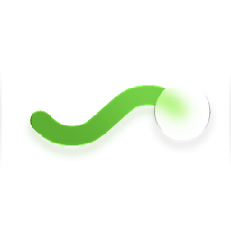
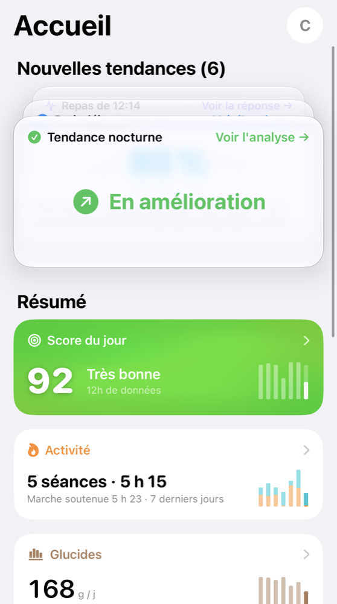
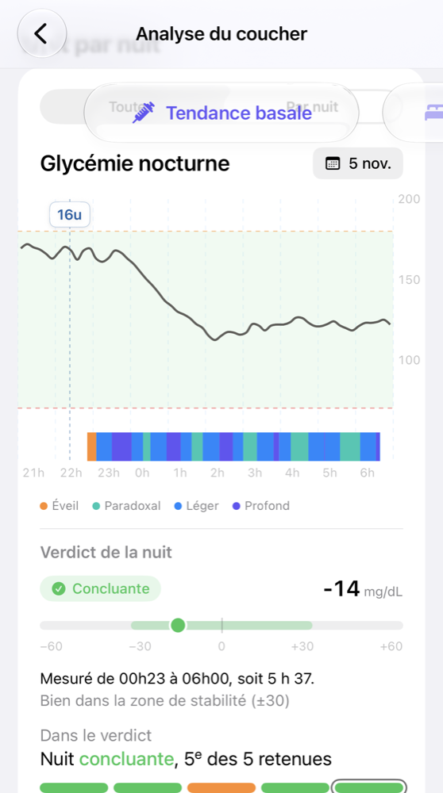
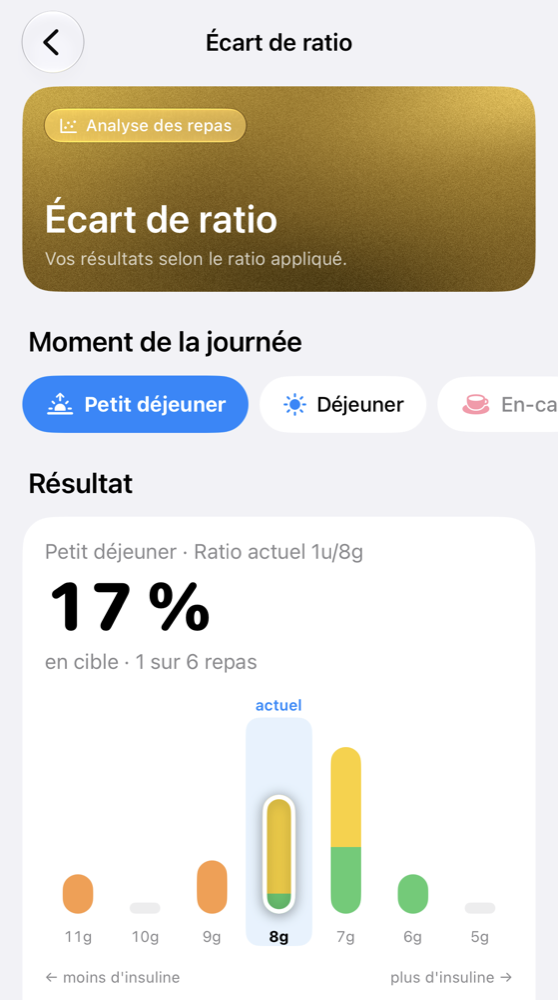
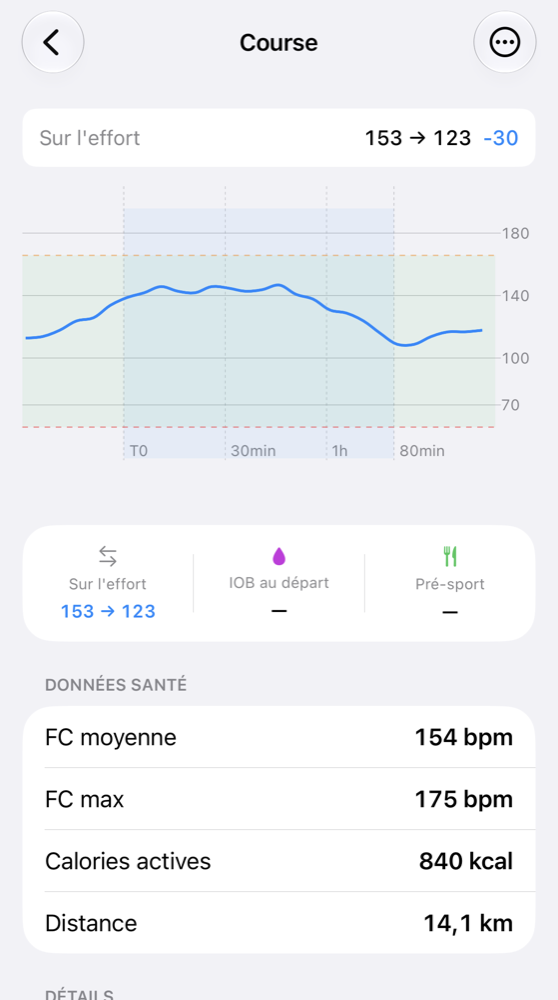
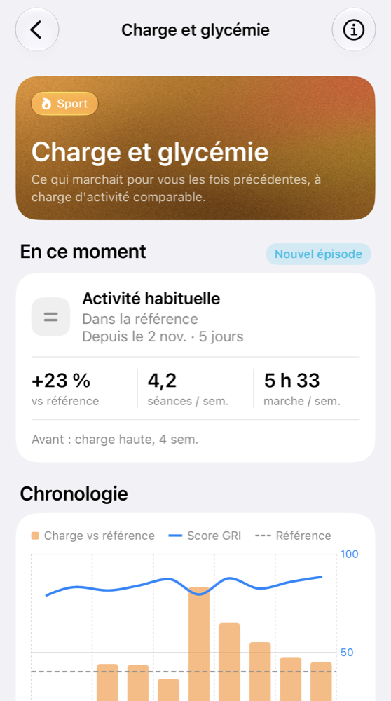
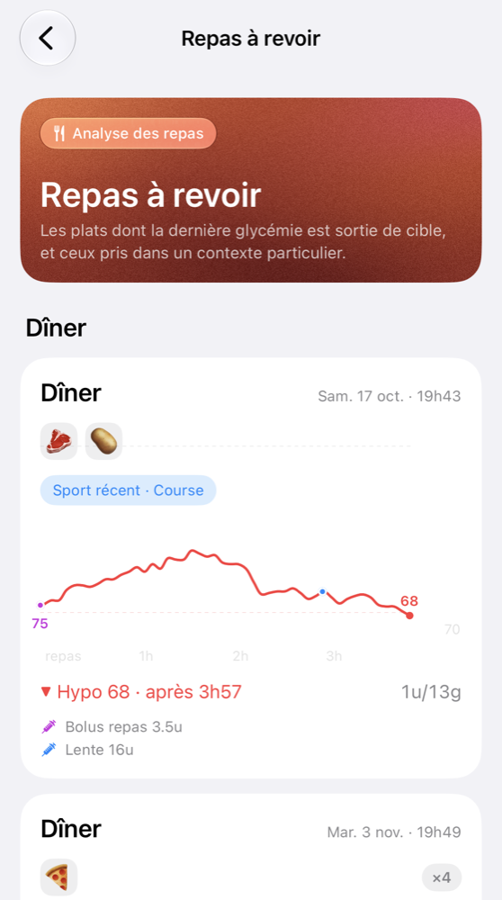
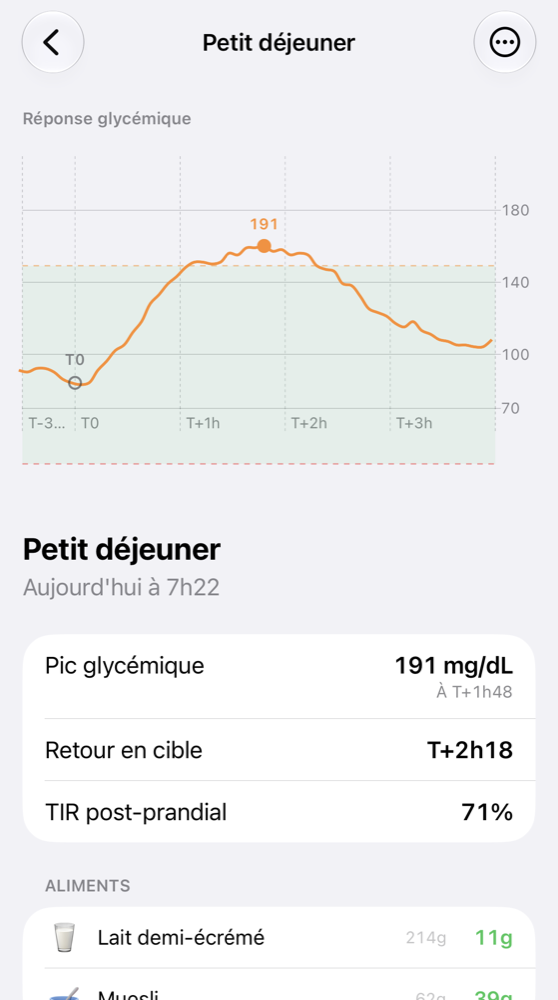
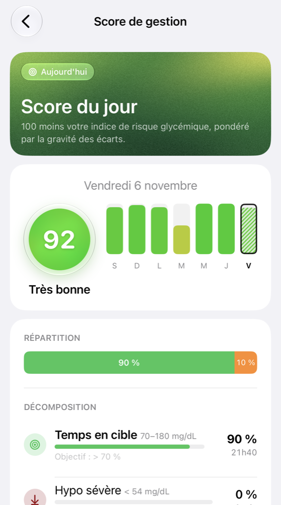
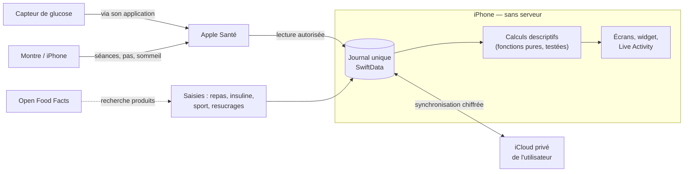

<p align="center">
  <picture>
    <source media="(prefers-color-scheme: dark)" srcset="docs/images/diaviz-icone-sombre.png">
    
  </picture>
</p>

<h1 align="center">Diaviz</h1>

<p align="center">
  Application iOS d'observation des données du diabète de type 1.<br>
  Swift 6 · SwiftUI · iOS 26 · SwiftData · CloudKit · HealthKit — entièrement sur l'appareil.
</p>

<p align="center"><b>Français</b> · <a href="README.en.md">English</a></p>

<h3 align="center"><a href="https://alexxbout.github.io/Diaviz/">Découvrir les notions de l'app sur le site →</a></h3>
<p align="center"><sub>Ce qu'elle observe, comment elle le calcule, ce qu'elle ne fait pas. Vos avis sont bienvenus.</sub></p>

> [!CAUTION]
> **Diaviz n'est pas un dispositif médical.** Ce dépôt contient le code source d'un outil personnel, partagé à titre éducatif et de démonstration technique. Il n'a fait l'objet d'aucune validation clinique, d'aucune certification (marquage CE) et n'est pas distribué en tant qu'application.
> **Ne prenez aucune décision de traitement (dose d'insuline, resucrage, alimentation, activité) sur la base de ce logiciel.** En cas de doute, référez-vous à votre lecteur de glycémie homologué et à votre équipe soignante. En cas d'hypoglycémie sévère ou d'urgence, appelez le 15 ou le 112.

---

## À propos

Une personne vivant avec un diabète de type 1 jongle chaque jour entre plusieurs applications : celle du capteur de glucose, un carnet de repas, un suivi d'activité. Les données existent, mais elles restent séparées, et personne ne les met en regard.

Diaviz rassemble ces trois sources dans un seul journal et les relit **après coup** : comment la glycémie a réagi à un repas, à une séance de sport, au cours d'une nuit. L'application décrit ce qui s'est passé et ce qui tend à se répéter. Elle ne calcule aucune dose et ne formule aucune recommandation.

<p align="center">
  
  
  
  
</p>

<p align="center">
  
  
  
  
</p>

<p align="center"><sub>Captures réalisées avec l'app « Diaviz Démo » : une personne fictive, aucune donnée réelle.</sub></p>

## Ce que l'application montre

Toutes les analyses sont de la **statistique descriptive**, recomptable à la main. Chacune est une observation, jamais une recommandation.

| Domaine | Ce qui est montré |
| --- | --- |
| **Score du jour** | Un score sur 100 dérivé du *Glycemia Risk Index* (Klonoff, 2022), avec sa décomposition et une « empreinte » visuelle de la journée, aussi disponible en widget d'écran d'accueil. |
| **Nuits** | L'évolution de la glycémie pendant la nuit, découpée en phases à partir de l'heure de l'insuline lente, avec les phases de sommeil d'Apple Santé en regard. |
| **Hypos au coucher** | Les situations du soir comptées telles quelles, et la possibilité de comparer une soirée aux soirées passées comparables. |
| **Repas** | La courbe de glycémie autour de chaque repas, et la comparaison des doses appliquées au ratio que l'utilisateur a lui-même configuré, par moment de la journée. Un repas dont la courbe est mélangée à un autre événement (autre repas, correction, resucrage, sport, insuline encore active) est écarté, avec sa raison. |
| **Sport** | La réponse glycémique de chaque séance, les prises de glucides pendant l'effort, un chronomètre en direct avec Live Activity, l'import des séances d'Apple Santé. |
| **Charge d'activité** | Ce qui reste actif des séances passées, marche soutenue comprise, comparé à la référence personnelle des semaines précédentes. Les épisodes de charge sont mis en regard des réglages en vigueur. |
| **Insuline active** | Une estimation de l'insuline rapide encore active, selon un modèle de décroissance publié. |
| **Bibliothèque** | Des fiches de synthèse sourcées sur la littérature scientifique, volontairement isolées de toute donnée personnelle. |

Quand les données sont insuffisantes, l'application l'affiche (« pas assez de recul ») plutôt que de produire un résultat fragile.

## Architecture

Tout tourne sur l'iPhone : **aucun serveur, aucun compte**.



| Brique | Choix |
| --- | --- |
| Interface | SwiftUI (iOS 26, Liquid Glass), WidgetKit, ActivityKit |
| Langage | Swift 6, concurrence stricte |
| Stockage | SwiftData comme journal unique (événements, profil, préférences) |
| Synchronisation | CloudKit, base privée de l'utilisateur, plus un export/import JSON complet |
| Glucose et activité | HealthKit, lecture incrémentale en arrière-plan |
| Analyses | Calculateurs purs, sans état, couverts par des tests unitaires |
| IA sur l'appareil | Apple Foundation Models, uniquement pour classer le texte libre décrivant le contexte d'un repas |
| Réseau | Une seule API : la recherche de produits Open Food Facts |

### Choix assumés

- **Pas d'apprentissage automatique.** Les premières pistes prévoyaient des modèles entraînés. Avec le volume de données d'une seule personne, ils auraient surtout appris du bruit. Les analyses livrées sont de la statistique descriptive : plus simple, vérifiable, et honnête sur son incertitude.
- **Rétrospectif par conception.** Les données de glucose transmises à Apple Santé arrivent avec plusieurs heures de retard. L'application ne prétend donc à aucun usage en temps réel : elle sert à relire, pas à réagir.
- **Une analyse bruitée est pire que pas d'analyse.** Les règles d'exclusion sont volontairement strictes, et chaque donnée écartée l'est avec sa raison affichée.
- **Pas de backend.** Les volumes sont faibles et les calculs prennent quelques millisecondes : un serveur n'apporterait que des risques.

## Structure du dépôt

```
Diaviz/
├── app/              point d'entrée, navigation
├── composants/       composants SwiftUI réutilisables
├── modeles/          modèles de domaine (glucose, insuline, repas, sport, profil…)
├── services/
│   ├── derivation/   calculateurs purs : nuits, repas, insuline active, charge…
│   ├── hub/          services qui lisent et écrivent le journal
│   └── sante/        lecture d'Apple Santé
└── vues/             écrans (accueil, repas, sport, journal, analyses, profil…)
DiavizSportWidget/    widget et Live Activity
DiavizTests/          tests unitaires
docs/                 documentation détaillée des analyses et de l'architecture
```

Prérequis techniques : Xcode 26, iOS 26.

## Statut réglementaire

- Diaviz est un **outil personnel**, non distribué.
- Il **n'est pas mis sur le marché** : aucune application n'est distribuée (ni App Store, ni TestFlight public, ni binaire téléchargeable). Seul le code source est publié.
- Il **n'est pas un dispositif médical** au sens du règlement (UE) 2017/745 et ne porte **aucun marquage CE**. Il n'a été évalué par aucun organisme notifié ni autorité de santé (ANSM, FDA ou autre).
- Par conception, le logiciel affiche des **observations rétrospectives** (ce qui s'est passé) et ne calcule **aucune dose**, ne formule **aucune recommandation thérapeutique** et n'émet **aucune alerte en temps réel**. Les données de glucose arrivent avec plusieurs heures de retard : l'outil est inutilisable pour une décision immédiate.
- Cette conception prudente **ne constitue pas** une garantie que le logiciel échapperait à la réglementation s'il était distribué. Certaines analyses (lecture de la glycémie nocturne, comparaison au ratio insuline/glucides configuré) seraient vraisemblablement qualifiées de dispositif médical dans ce cas.
- Aucun droit d'utilisation, de modification ou de distribution n'est accordé (voir [LICENSE](LICENSE)). **Toute personne qui distribuerait malgré tout ce code ou un dérivé**, gratuitement ou non, le ferait sans autorisation, deviendrait seule « fabricant » au sens de la réglementation et porterait l'intégralité des obligations correspondantes (qualification, évaluation clinique, marquage CE, système de management de la qualité, vigilance, protection des données).

## Clause de non-responsabilité

- Ce code est rendu visible **« en l'état »**, sans garantie d'aucune sorte, expresse ou implicite. Il peut contenir des erreurs de calcul, d'affichage ou d'interprétation des données.
- Les scores, verdicts, tendances et analyses affichés sont des **indicateurs personnels, non validés scientifiquement ni cliniquement**. Ils peuvent être faux, incomplets ou trompeurs, notamment en cas de données manquantes, de saisie approximative ou de défaut du capteur.
- Ce logiciel **ne remplace pas** un avis médical, un suivi par une équipe soignante, ni les outils homologués (application du fabricant de votre capteur, Dexcom Clarity, LibreView, etc.).
- Aucune licence d'utilisation n'est accordée. L'auteur **ne recommande à personne** d'installer ou d'utiliser ce logiciel pour gérer sa santé. Toute compilation, installation ou utilisation par un tiers se fait sans autorisation et **sous sa seule et entière responsabilité**.
- Dans toute la mesure permise par la loi applicable, l'auteur ne saurait être tenu responsable d'un quelconque dommage, direct ou indirect, résultant de l'utilisation ou de l'impossibilité d'utiliser ce code ou un logiciel qui en dérive.
- Le dépôt est un projet **non commercial** : il n'est ni vendu, ni monétisé, ni associé à une prestation de service.
- Aucune demande d'aide médicale ne sera traitée via ce dépôt (issues, discussions, messages).

## Données et vie privée

- **Aucun serveur.** Le logiciel n'a pas de backend. Les données de santé restent sur l'iPhone (stockage local) et, si iCloud est activé, dans la **base privée iCloud de l'utilisateur** (CloudKit), chiffrée et gérée par Apple. L'auteur n'a **aucun accès** à ces données, ni technique ni contractuel.
- **Glucose** : lu depuis Apple Santé (HealthKit), avec l'autorisation explicite de l'utilisateur. Aucune connexion directe à un service de fabricant de capteur.
- **Seul appel réseau** : la recherche de produits alimentaires sur l'API publique Open Food Facts (texte recherché ou code-barres). **Aucune donnée de santé** n'y est transmise.
- **Intelligence artificielle** : un modèle de langage Apple (Foundation Models) tourne **sur l'appareil**, uniquement pour classer le texte libre de contexte d'un repas. Aucun service d'IA distant, aucune donnée envoyée à un tiers.
- **Aucune** analyse d'audience, publicité, télémétrie ou rapport de plantage envoyé à l'auteur.
- L'utilisateur peut exporter l'intégralité de ses données (fichier JSON) et tout supprimer depuis l'app.
- L'auteur ne collecte ni ne traite les données de quiconque. Une personne qui utilise ce code reste seule maîtresse — et seule responsable — de ses propres données.

## Contributions

Le dépôt est public pour être lu, pas pour devenir un projet communautaire. Les contributions de code (pull requests) ne sont pas acceptées. Les retours et questions techniques sont bienvenus via les issues, à l'exclusion de toute demande d'aide médicale.

## Licence

© 2026 Alexandre Boutinaud — **tous droits réservés**. Voir [LICENSE](LICENSE).

Le code source est rendu **visible** à des fins de consultation, de démonstration et de recherche. Ce n'est **pas** un projet open source : aucun droit de copie, de modification, de distribution, de publication (y compris sur une boutique d'applications) ou de réutilisation, totale ou partielle, n'est accordé sans autorisation écrite de l'auteur. Le nom « Diaviz », son icône et son identité visuelle sont également réservés.

La consultation du dépôt et la copie technique (« fork ») permises par les conditions d'utilisation de GitHub ne confèrent aucun autre droit.

## Marques

Dexcom, Apple, iPhone, Apple Santé (HealthKit), iCloud, FreeStyle Libre et les autres noms cités sont des marques de leurs détenteurs respectifs. Ce projet n'est ni affilié, ni approuvé, ni soutenu par aucun d'entre eux. Leur mention sert uniquement à décrire une compatibilité technique.

## Sources de données tierces

- **Open Food Facts** — données sous licence [Open Database License (ODbL)](https://opendatacommons.org/licenses/odbl/1-0/), contenus sous [CC BY-SA](https://creativecommons.org/licenses/by-sa/3.0/). © les contributeurs d'Open Food Facts.
- **Table CIQUAL** — Anses. Table de composition nutritionnelle des aliments Ciqual. Licence Ouverte Etalab.
- **Bibliothèque** — les fiches sont des synthèses, non des reproductions, de publications citées avec leurs références, notamment : Battelino et al., *Diabetes Care*, 2019 (consensus international sur le temps dans la cible) ; Klonoff et al., *Journal of Diabetes Science and Technology*, 2022 (Glycemia Risk Index) ; recommandations de l'American Diabetes Association publiées dans *Diabetes Care*.
